<div align="center">

# AWS Lambda + DynamoDB + S3 Backup

### A Serverless Data Import and Automated Backup Workflow

[](https://aws.amazon.com/lambda/)
[](https://aws.amazon.com/dynamodb/)
[](https://aws.amazon.com/s3/)
[](https://aws.amazon.com/eventbridge/)
[](https://aws.amazon.com/cloudwatch/)
[](https://www.python.org/)
[](https://aws.amazon.com/serverless/)

</div>

---

## Project Overview

This hands-on AWS project demonstrates a serverless workflow for importing sample user data from the JSONPlaceholder API into Amazon DynamoDB and exporting table records to Amazon S3 as timestamped JSON backups.

AWS Lambda runs the application logic, IAM execution roles control access, Amazon EventBridge Scheduler provides recurring invocation, and Amazon CloudWatch supports logging and monitoring.

**AWS Region used for the exercise:** `us-west-2` (Oregon)

> **Schedule status:** The schedule was last reported as disabled. Check its current state in the AWS console before expecting recurring backups.

## Architecture

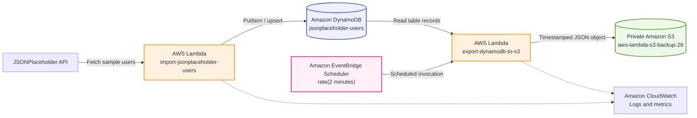

## How It Works

1. **Fetch sample users.** The import Lambda requests user data from JSONPlaceholder.
2. **Write records to DynamoDB.** User items are stored in the `jsonplaceholder-users` table, using the numeric `id` partition key.
3. **Export the table.** The backup Lambda reads records from DynamoDB and serializes the data as JSON.
4. **Store the backup in S3.** The exported JSON is written to the configured private S3 bucket under a date-based prefix.
5. **Schedule the backup.** EventBridge Scheduler can invoke the backup Lambda using a `rate(2 minutes)` schedule.
6. **Observe execution.** CloudWatch Logs and metrics help verify function behavior and troubleshoot failures.

## Technology Stack

| Service / Tool | Role in this project |
| --- | --- |
|  | Runs import and backup code without managing servers |
|  | Stores imported user records |
|  | Stores exported JSON backup objects |
|  | Triggers recurring backup runs |
|  | Provides logs, invocation metrics, and troubleshooting data |
|  | Controls the permissions available to each Lambda function |
|  | Implements the Lambda functions |
|  | Stores source code and documentation |

## Repository Structure

```text
lambda-dynamodb-s3backup/
├── README.md
├── .gitignore
├── Screenshots/
│   ├── 01-dynamodb-table-creation.png
│   ├── 02-s3-bucket-creation.png
│   ├── 03-lambda-iam-role.png
│   ├── 04-lambda-policy-attached.png
│   ├── 05-import-lambda-environment-variables.png
│   ├── 06-import-lambda-test-result.png
│   ├── 07-import-lambda-cloudwatch-logs.png
│   ├── 08-dynamodb-user-records.png
│   ├── 09-backup-lambda-creation.png
│   ├── 10-backup-lambda-permissions.png
│   ├── 11-backup-lambda-environment-variables.png
│   └── 12-backup-lambda-test-result.png
├── iam_policies/
│   ├── lambda-import-putitem-policy.json
│   └── lambda-backup-export-policy.json
├── lambda_src/
│   ├── import_users/
│   │   └── lambda_function.py
│   └── backup_users/
│       └── lambda_function.py
└── lambda_zips/
    ├── lambda-import-users.zip
    └── lambda-backup-to-s3.zip
```

## Lambda Functions

### 1. Import users — `import_users`

- Retrieves sample user records from JSONPlaceholder.
- Writes items to the `jsonplaceholder-users` DynamoDB table.
- Uses DynamoDB `PutItem` operations.
- Writes execution details and errors to CloudWatch Logs.

### 2. Export backup — `backup_users`

- Reads records from the DynamoDB table.
- Serializes the returned items as JSON.
- Uploads the export to the configured S3 bucket.
- Uses date-based prefixes and timestamped object names, according to the deployed implementation.
- Writes execution details and errors to CloudWatch Logs.

## Configuration Reference

| Setting | Value used in the exercise |
| --- | --- |
| AWS Region | `us-west-2` (Oregon) |
| DynamoDB table | `jsonplaceholder-users` |
| Partition key | `id` — Number |
| S3 bucket | `aws-lambda-s3-backup-26` |
| Backup prefix pattern | `backups/YYYY-MM-DD/` |
| Scheduler expression | `rate(2 minutes)` |
| Export format | JSON |

Use the actual deployed function configuration as the source of truth if any value differs.

## IAM and Security

The repository contains separate policy documents for the import and backup functions.

- **Import role:** allow only the DynamoDB actions required to write records and inspect the target table.
- **Backup role:** allow the required DynamoDB read/scan actions and S3 object writes to the intended destination.
- Keep the backup bucket private and grant access only to authorized principals.
- Prefer resource-specific ARNs instead of broad wildcard permissions whenever possible.
- Never commit AWS access keys, secret keys, session tokens, or local environment files.
- Review IAM policies before reusing them in another account; confirm actions and resource ARNs match the deployment.

## Deployment and Test Checklist

Follow this sequence when reproducing the lab in your own AWS account.

1. **Create the DynamoDB table** named `jsonplaceholder-users`, with partition key `id` of type Number.
2. **Create a private S3 bucket** in the selected Region. S3 bucket names must be globally unique.
3. **Create IAM execution roles** for the import and backup Lambda functions.
4. **Review and attach policies** from `iam_policies/`, restricting resources to the intended table and bucket.
5. **Deploy the import Lambda** using `lambda_zips/lambda-import-users.zip`.
6. **Run an import test** and verify the function response and DynamoDB items.
7. **Deploy the backup Lambda** using `lambda_zips/lambda-backup-to-s3.zip`.
8. **Run a backup test** and verify the JSON object exists in S3.
9. **Configure EventBridge Scheduler** to invoke the backup function at the required interval. Check the target, invocation role, and enabled state.
10. **Verify CloudWatch Logs and metrics** for both functions.
11. **Confirm repeated backups** create separate objects with distinct timestamps, if the function is designed to do so.

The ZIP archives are deployment artifacts. If you change the Python source, rebuild the corresponding ZIP before uploading it to Lambda.

## Screenshots and Implementation Evidence

The screenshots below are linked using the descriptive filenames intended for the `Screenshots/` directory. GitHub will render them in this README after those image files have been committed to the repository with exactly matching names.

### 01. DynamoDB table creation

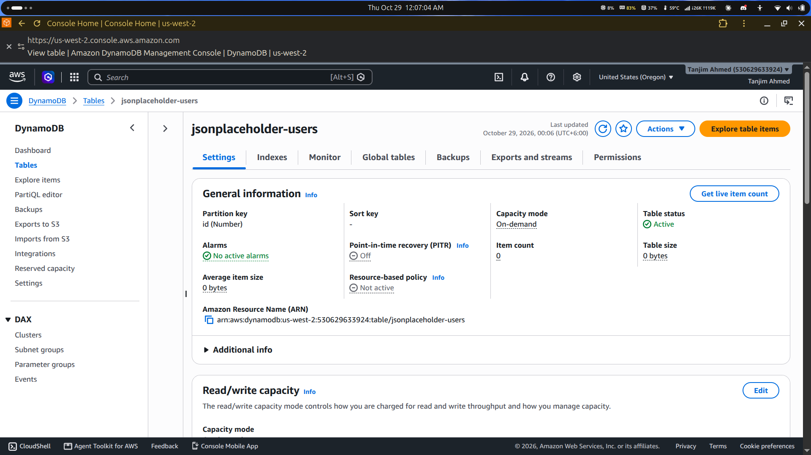

### 02. S3 bucket creation

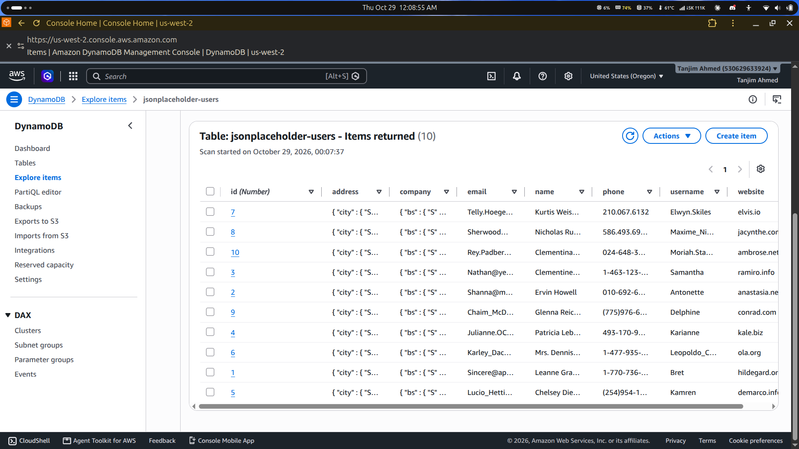

### 03. IAM role for Lambda

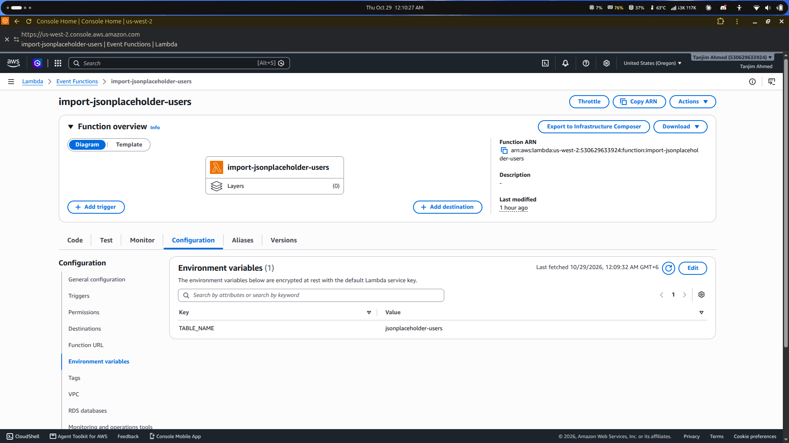

### 04. Lambda policy attached

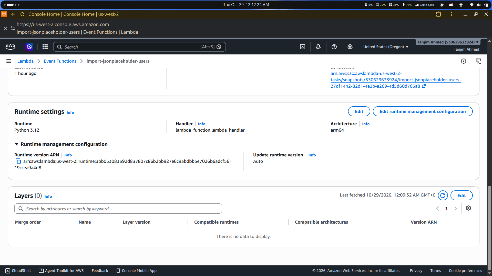

### 05. Import Lambda environment variables

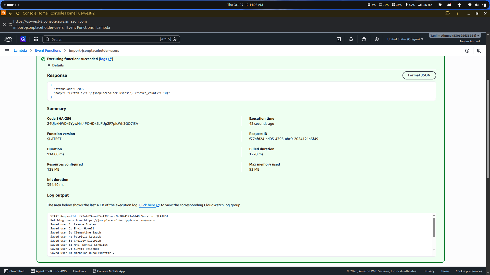

### 06. Import Lambda test result

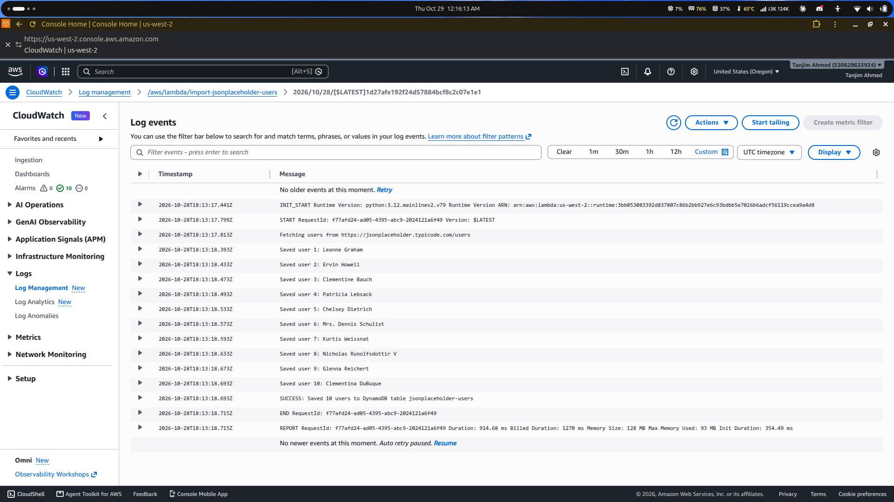

### 07. Import Lambda CloudWatch logs

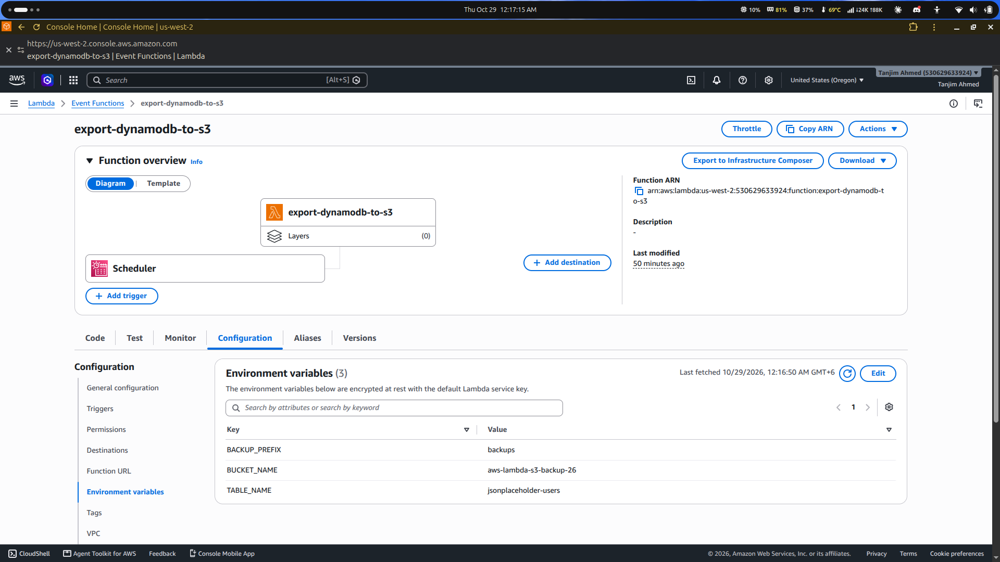

### 08. DynamoDB user records

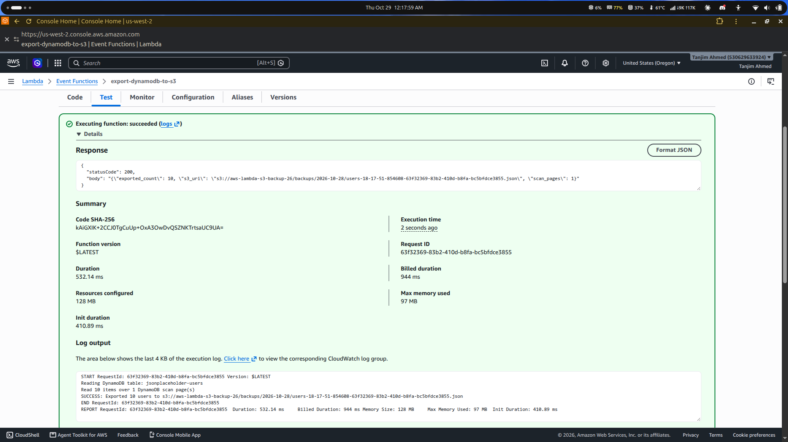

### 09. Backup Lambda creation

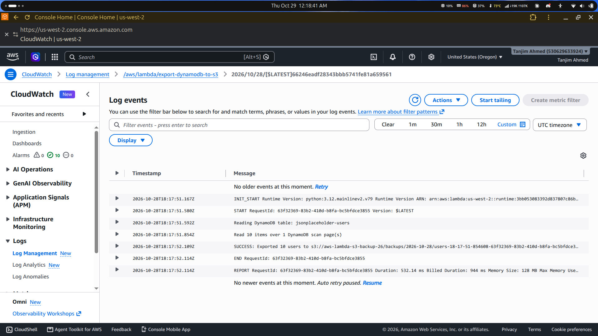

### 10. Backup Lambda permissions

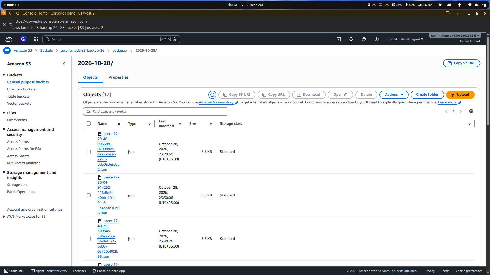

### 11. Backup Lambda environment variables

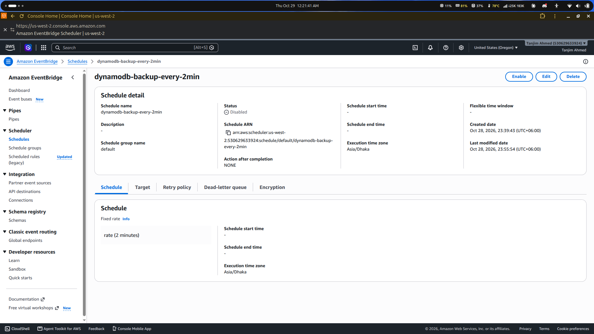

### 12. Backup Lambda test result

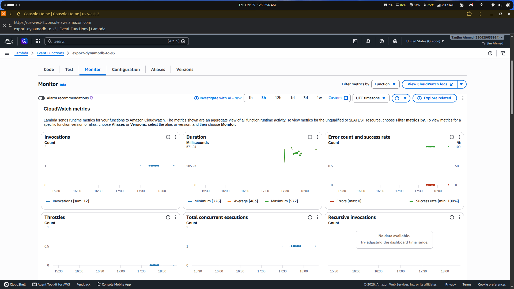

## Homework Questions and Key Concepts

### What is the purpose of IAM roles?

IAM roles provide AWS services with temporary permissions to access resources. Lambda assumes its execution role rather than requiring embedded long-term AWS access keys.

### What does EventBridge Scheduler do?

It invokes a configured target according to a schedule. A schedule that is disabled will not trigger recurring runs.

### Why store exported data in S3?

S3 provides durable object storage for backup files. Timestamped exports can preserve multiple copies of the data over time.

### Why does importing the same users not increase the record count?

DynamoDB `PutItem` writes an item identified by its primary key. When an imported record has an existing `id`, it replaces that item rather than creating a second item with the same key.

### Why should a backup filename include a timestamp?

Unique timestamped object names make it easier to distinguish backup runs and reduce the chance of overwriting a previous export.

### What is the difference between CloudWatch Logs and metrics?

Logs contain detailed execution messages and errors. Metrics are numeric measurements, such as invocation count, errors, and duration, that can be graphed and monitored.

### Does a JSON export restore the entire DynamoDB table?

No. An item export contains data records, not the full table configuration. A recovery process may also need to recreate keys, indexes, billing settings, encryption settings, and other configuration.

### Why is scanning the whole table every two minutes unsuitable for many production systems?

Frequent full-table scans can increase read usage, cost, latency, and throttling risk as data grows. Evaluate DynamoDB point-in-time recovery, on-demand backups, or a purpose-built export process for production recovery requirements.

## Troubleshooting

| Problem | Checks |
| --- | --- |
| Lambda reports access denied | Inspect the execution role, policy actions, resource ARNs, and Region |
| Import returns successfully but records are missing | Check the table name, Region, response payload, and CloudWatch Logs |
| S3 upload fails | Verify bucket configuration, `s3:PutObject`, bucket policy, and destination prefix |
| Scheduled backups do not appear | Confirm the schedule is enabled, its target is correct, and its role can invoke Lambda |
| Repeated imports keep the same item count | Check whether the same primary-key values are being upserted |
| Backup JSON exists but table settings are missing | Recreate table configuration separately; exported JSON contains item data only |

## Production Considerations

- Use DynamoDB point-in-time recovery or AWS Backup where suitable for recovery objectives.
- Handle DynamoDB pagination when exporting tables that can exceed a single scan response.
- Plan for Lambda timeout, memory, retries, and duplicate invocations.
- Consider S3 encryption, lifecycle retention, versioning, and access controls.
- Monitor failed invocations and periodically verify that backup files can be read and used.
- Avoid frequent full-table scans for large production tables without evaluating capacity and cost.

## Cleanup and Cost Control

When the lab is no longer needed, review and remove resources carefully.

1. Disable and delete the EventBridge schedule.
2. Delete the two Lambda functions if they are no longer required.
3. Delete the DynamoDB table if its data is no longer needed.
4. Empty the S3 bucket before deleting it; check object versions if versioning is enabled.
5. Review and delete related CloudWatch log groups if the logs are no longer required.
6. Remove only the IAM roles and policies created for this exercise, after confirming they are not shared with another workload.

Verify the resource and its dependencies in the AWS console before deleting anything.

---

<div align="center">

**AWS Lambda · Amazon DynamoDB · Amazon S3 · EventBridge Scheduler · CloudWatch · IAM**

*Serverless architecture, secure permissions, automated data export, and operational visibility.*

</div>
