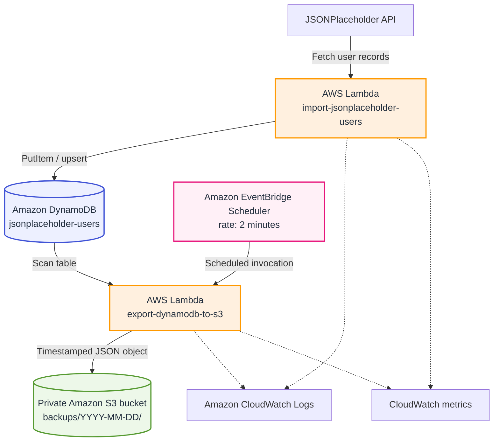

<!-- AWS Lambda + DynamoDB + S3 Backup -->

<div align="center">

# AWS Lambda + DynamoDB + S3 Backup

### Serverless data import and timestamped backups to Amazon S3

[](https://aws.amazon.com/lambda/)
[](https://aws.amazon.com/dynamodb/)
[](https://aws.amazon.com/s3/)
[](https://aws.amazon.com/eventbridge/)
[](https://aws.amazon.com/cloudwatch/)

</div>

---

## Overview

This project demonstrates a serverless AWS workflow that imports user records from the JSONPlaceholder API into Amazon DynamoDB and exports table data to a private Amazon S3 bucket as timestamped JSON backup files. AWS Lambda performs the application logic, IAM roles provide scoped permissions, Amazon EventBridge Scheduler can trigger recurring backups, and Amazon CloudWatch captures execution logs and metrics.

The project was completed as a hands-on AWS homework assignment, with an emphasis on serverless architecture, access control, data export, scheduling, and observability.

## Architecture



## Workflow

1. **Import users** — the import Lambda retrieves user data from JSONPlaceholder.
2. **Write to DynamoDB** — records are written to the `jsonplaceholder-users` table, using numeric `id` as the partition key.
3. **Create a backup** — the export Lambda scans the table and serializes the returned records as JSON.
4. **Store in S3** — the backup is uploaded to the private bucket `aws-lambda-s3-backup-26`, organized under date-based prefixes with a timestamped filename.
5. **Schedule and observe** — EventBridge Scheduler is configured for a two-minute interval for the exercise; Lambda execution details and metrics are available through CloudWatch.

> **Schedule status:** The schedule was last reported as disabled. Enable it in AWS only when you want to run the recurring demonstration. Do not assume scheduled backups are running while it is disabled.

## AWS Services and Tools

| Service | Purpose |
| --- | --- |
| AWS Lambda | Runs the import and export functions without managing servers |
| Amazon DynamoDB | Stores the imported user records |
| Amazon S3 | Stores private, timestamped JSON backup objects |
| Amazon EventBridge Scheduler | Invokes the backup Lambda on a recurring schedule |
| Amazon CloudWatch | Collects Lambda logs, invocation metrics, and troubleshooting information |
| AWS IAM | Grants each Lambda only the permissions required for its task |
| JSONPlaceholder | Provides sample user data for the import workflow |
| Python | Implements the Lambda functions |
| Git and GitHub | Version control and project documentation |

## Repository Structure

```text
lambda-dynamodb-s3backup/
├── README.md
├── .gitignore
├── Screenshots/
│   ├── 01-dynamodb-table-creation.png
│   ├── 02-s3-bucket-creation.png
│   ├── 03-lambda-iam-role.png
│   ├── 04-lambda-policy-attached.png
│   ├── 05-import-lambda-environment-variables.png
│   ├── 06-import-lambda-test.png
│   ├── 07-import-lambda-cloudwatch-logs.png
│   ├── 08-dynamodb-user-records.png
│   ├── 09-backup-lambda-creation.png
│   ├── 10-backup-lambda-permissions.png
│   ├── 11-backup-lambda-environment-variables.png
│   └── 12-backup-lambda-test.png
├── iam_policies/
│   ├── lambda-import-putitem-policy.json
│   └── lambda-backup-export-policy.json
├── lambda_src/
│   ├── import_users/
│   │   └── lambda_function.py
│   └── backup_users/
│       └── lambda_function.py
└── lambda_zips/
    ├── lambda-import-users.zip
    └── lambda-backup-to-s3.zip
```

*The tree above documents the intended layout. Keep your actual source filenames and screenshot filenames consistent with the files committed to this repository.*

## Lambda Functions

### 1. Import users — `import_users`

**Responsibility:** Retrieve sample users from JSONPlaceholder and write them into DynamoDB.

- Calls the external JSONPlaceholder users endpoint.
- Writes records to the `jsonplaceholder-users` table.
- Uses DynamoDB `PutItem` operations.
- Emits execution results and errors to CloudWatch Logs.

### 2. Export backup — `backup_users`

**Responsibility:** Export the DynamoDB records to S3 as JSON.

- Scans the DynamoDB table for records.
- Serializes the records as JSON.
- Creates a timestamped backup object in a date-based S3 prefix.
- Logs the result or failure for troubleshooting.

## Data and Backup Layout

- **DynamoDB table:** `jsonplaceholder-users`
- **Partition key:** `id` (Number)
- **S3 bucket:** `aws-lambda-s3-backup-26`
- **Backup prefix pattern:** `backups/YYYY-MM-DD/`
- **Backup format:** JSON

A timestamp in the object name helps distinguish separate exports and prevents one backup from unintentionally replacing another when unique names are generated.

## IAM and Security

The Lambda functions use execution roles rather than embedded AWS access keys.

- **Import function:** permissions should cover only the required DynamoDB write and any necessary table-description/list operations.
- **Backup function:** permissions should cover reading/scanning the target table and writing objects to the intended S3 bucket/prefix.
- Keep the S3 bucket private and grant access only to authorized principals.
- Avoid committing credentials, account-specific secrets, or local environment files.
- Review the supplied policies in `iam_policies/` and narrow resource ARNs to the exact table and bucket wherever possible.
- Do not attach broad administrative permissions to Lambda execution roles.

The policies in this repository are examples for the homework workflow. Validate resource ARNs and required actions before reusing them in another AWS account.

## Setup and Deployment

This repository contains the Lambda source code, IAM policy documents, and deployment ZIPs. The following is the high-level deployment sequence; use the actual values from your AWS account.

1. **Create the DynamoDB table** named `jsonplaceholder-users` with partition key `id` of type Number.
2. **Create a private S3 bucket** in your selected AWS Region. Confirm the bucket name is globally unique.
3. **Create IAM execution roles** for the two Lambda functions and attach the appropriate least-privilege policies.
4. **Deploy the import Lambda** using `lambda_zips/lambda-import-users.zip`. Configure any required environment variables and execution settings.
5. **Deploy the backup Lambda** using `lambda_zips/lambda-backup-to-s3.zip`. Configure the target table and bucket values expected by the source code.
6. **Test the import function** manually and verify that records appear in DynamoDB.
7. **Test the backup function** manually and verify that a timestamped JSON object appears in the S3 backup prefix.
8. **Configure EventBridge Scheduler** to invoke the backup Lambda at the intended interval. Confirm its state and target role before expecting automatic runs.
9. **Verify CloudWatch Logs and metrics** after test and scheduled invocations.

**Region used for the exercise:** `us-west-2` (Oregon).

## Screenshots

The `Screenshots/` directory is intended to document the homework implementation in order. The images below should be committed with the exact filenames shown.

| # | Evidence | Image |
| ---: | --- | --- |
| 01 | DynamoDB table creation |  |
| 02 | S3 bucket creation |  |
| 03 | IAM role for Lambda |  |
| 04 | Lambda policy attached |  |
| 05 | Import Lambda environment variables |  |
| 06 | Import Lambda test result |  |
| 07 | Import Lambda CloudWatch logs |  |
| 08 | DynamoDB user records |  |
| 09 | Backup Lambda creation |  |
| 10 | Backup Lambda permissions |  |
| 11 | Backup Lambda environment variables |  |
| 12 | Backup Lambda test result |  |

Additional evidence recommended for a complete submission, if captured: S3 objects showing multiple timestamped backups, EventBridge Scheduler configuration and state, and CloudWatch invocation metrics. Do not add screenshots that were not actually captured.

## Homework Concepts and Answers

### What is the purpose of IAM roles?

IAM roles provide temporary, controlled permissions to AWS services. Lambda assumes its execution role to access resources such as DynamoDB, S3, and CloudWatch without hard-coded access keys.

### What does EventBridge Scheduler do?

It invokes a configured target, such as the backup Lambda, on a schedule. A configured schedule does not run while it is disabled.

### Why store backups in S3?

S3 provides durable object storage that can hold multiple timestamped exports independently of the live DynamoDB table.

### Why does importing the same users still leave the same number of records?

DynamoDB `PutItem` writes an item using its primary key. When an imported record has an existing `id`, the write replaces that item instead of creating a duplicate with the same key.

### Why should backup filenames include a timestamp?

A unique timestamp helps preserve multiple backup versions and makes it easier to identify when each export was created.

### What is the difference between logs and metrics?

CloudWatch Logs contain detailed execution messages and errors. Metrics provide numeric measurements such as invocation count, duration, and errors that can be graphed or monitored.

### Can a JSON export fully restore a DynamoDB table?

The JSON export contains item data, not the full table configuration. A complete recovery process must also recreate or configure the table schema, keys, indexes, capacity or billing settings, and other required configuration.

### Why is scanning a table every two minutes not ideal for production backups?

Frequent full-table scans can increase read consumption, cost, latency, and throttling risk as the table grows. For production recovery needs, evaluate native DynamoDB point-in-time recovery, on-demand backups, or a purpose-built export workflow.

## Troubleshooting

| Symptom | What to check |
| --- | --- |
| Lambda returns an access-denied error | Verify the execution role, attached policy, action names, and resource ARNs |
| Import succeeds but no items appear | Confirm the table name and Region, inspect the Lambda response, and review CloudWatch Logs |
| Backup Lambda cannot upload to S3 | Check `s3:PutObject`, the bucket name, object prefix, and bucket policy |
| No scheduled backups appear | Confirm the schedule is enabled, its target is correct, and its execution role can invoke the Lambda |
| Repeated imports do not increase the item count | Check whether the same primary-key values are being upserted |
| Backup object exists but cannot restore table settings | Recreate table configuration separately; the JSON contains exported items only |

## Cleanup and Cost Control

When the homework is no longer needed, clean up resources carefully to avoid unexpected charges.

1. Disable and delete the EventBridge schedule.
2. Delete the two Lambda functions if they are no longer needed.
3. Delete the DynamoDB table if its data is no longer required.
4. Empty the S3 bucket before deleting it. Check for object versions if versioning is enabled.
5. Delete the relevant CloudWatch log groups if the logs are no longer required.
6. Remove only the IAM roles and policies created specifically for this exercise, after confirming they are not used by another workload.

Check the AWS console for the current resource state before deleting anything. Retain any evidence or backup data required for your submission.

## Learning Outcomes

- Built a serverless data ingestion and export workflow.
- Practiced DynamoDB item writes and table scans.
- Stored timestamped JSON backups in S3.
- Applied IAM execution roles and resource permissions.
- Used EventBridge Scheduler for recurring invocation.
- Used CloudWatch logs and metrics to validate and troubleshoot execution.
- Considered backup reliability, security, and production scaling trade-offs.

---

<div align="center">

**Built as a hands-on AWS serverless homework project**

AWS Lambda · Amazon DynamoDB · Amazon S3 · EventBridge Scheduler · CloudWatch · IAM

</div>
